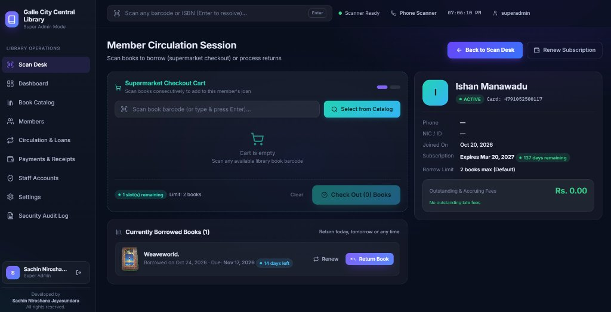

<div align="center">

# Library Management System
### Professional Desktop Edition for Windows

**High-Speed Barcode Circulation | Built-In Barcode & Label Printer Studio | WhatsApp Reminders | Recurring Member Subscriptions | Physical Return Verification | Offline-First SQLite Engine**

[](https://github.com/sac3478/library-management-releases/releases/latest)
[-0078D6?style=for-the-badge&logo=windows&logoColor=white)](https://github.com/sac3478/library-management-releases/releases/latest)
[](https://github.com/sac3478/library-management-releases/releases/latest)
[](mailto:sac3478@gmail.com)

---

[**Download Latest Installer (.exe)**](https://github.com/sac3478/library-management-releases/releases/latest) | [**24-Hour Free Trial Key**](#24-hour-free-evaluation-license-key) | [**Full Feature Overview**](#comprehensive-feature-overview) | [**Pricing & Instant Buy ($10 / $29 / $49)**](#commercial-licensing-pricing--instant-paypal-checkout)

<br />



</div>

---

## Overview

**Library Management System (Professional Desktop Edition)** is a fast, supermarket-style circulation, barcode printing, and inventory management application built for **public libraries, schools, colleges, private reading clubs, and institutional resource centers worldwide**.

Unlike slow, browser-dependent web tools that stop working when the internet connection drops, Library Management System runs natively on Windows with an embedded **SQLite WAL database**. Daily operations such as scanning member cards, checking out carts of books, printing barcode stickers, verifying physical book returns, calculating overdue fines, printing receipts, and generating audit reports execute in **under 5 milliseconds** with **100% offline reliability**.

---

## 24-Hour Free Evaluation License Key

You can use the following **24-Hour (1-Day) Evaluation Product Key** to install and test every feature of the software on your own library hardware before purchasing a full commercial license.

> *(This key is also available in [`TRIAL_LICENSE_KEY.md`](./TRIAL_LICENSE_KEY.md) in this repository.)*

```text
LMS-FREE-24HR-DEMO-2026
```

### How the 24-Hour Evaluation Key Works:
1. **Download & Install**: Download the latest `Library-Management-Setup-x.x.x.exe` from the [**Releases**](https://github.com/sac3478/library-management-releases/releases/latest) page and launch the application.
2. **Paste the Key**: Enter `LMS-FREE-24HR-DEMO-2026` on the **Activate Product** screen and click **Activate Application** *(requires a brief internet connection to bind the evaluation certificate)*.
3. **Full Access for 24 Hours**: Unlocks all Super Admin, barcode circulation, barcode label printing, smartphone scanner, catalog, and reporting features for **24 hours (1 full day)**.
4. **Hardware Policy (1 Use Per Computer)**:
   - This evaluation key is bound to your computer's unique **Hardware Machine ID (`LM-XXXX-XXXX-XXXX-XXXX`)** upon first use.
   - **Once activated on a computer, the evaluation key cannot be used on that same computer again** (even if the application is uninstalled or reinstalled).
5. **Upgrading to a Full License (Zero Data Loss)**:
   - When your 24-hour evaluation expires, or if the evaluation key is unavailable, you can purchase a **Monthly ($10)**, **Annual ($29)**, or **Lifetime ($49)** Product Key online or contact **`sac3478@gmail.com`**.
   - All books, members, loans, payments, and settings configured during your evaluation remain **100% intact** when you activate your full license key.

---

## Comprehensive Feature Overview

### 1. Supermarket-Style High-Speed Scan Desk
- **Instant Context Switching**: Scan any **Member Card** at the main desk to immediately open that patron's live profile, showing active loans, remaining borrow slots, subscription expiry countdown, and any unpaid late fees.
- **Multi-Book Shopping Cart Checkout**: Scan multiple books one after another into the checkout cart and complete the entire lending transaction in a single click.
- **Audio-Visual Scan Feedback**: Clear scan beeps and visual confirmation indicators let librarians process queues quickly without looking at the keyboard.
- **Smart Unknown Barcode Routing**: Scanning an unrecognized barcode prompts the librarian to either register it as a **New Book** (with automatic online ISBN lookup) or assign it to a **New Member**.

### 2. Dual Barcode Scanner Support (USB Handheld + Smartphone Camera)
- **Plug-and-Play Hardware Scanners**: Works with all standard USB and Bluetooth 1D/2D laser and CCD barcode scanners out of the box, and includes a built-in **Hardware Scanner Diagnostics & Test Utility**.
- **Built-in Wireless Smartphone Camera Scanner**:
  - If you do not have a dedicated USB laser scanner at every desk, click **Phone Scanner** in the top bar and scan the on-screen **QR Code** with any **iPhone or Android** phone on the same Wi-Fi network.
  - Turns the smartphone camera into a live wireless barcode reader and also lets staff take and upload **physical book cover photos** directly from their phone into the catalog.

### 3. Built-In Barcode & Label Studio (Thermal Roll Printers & A4 Sticker Sheets)
- **Generate Collision-Free Barcodes**: If you do not have pre-printed member cards or books with ISBN barcodes, you can generate sequential, unique **Code 128B** barcodes (`BK-00001`, `MEM-00001`) directly inside the app.
- **3 Label Printing Modes**:
  - **Book Labels with Details**: Print spine or cover stickers showing the **Library Name, Book Title, Author, Category, Shelf Location, and Code 128B Barcode**.
  - **Member Card Labels & CR80 ID Cards with Details**: Print member cards or stickers showing the **Library Name, Member Full Name, Parent/Guardian, Phone, NIC/ID, Subscription Expiry, and Card Barcode**.
  - **Batch Unassigned Barcodes**: Pre-print sheets or rolls of sequential blank book or member barcodes in bulk and assign them later at the Scan Desk by scanning them.
- **11 Built-in Printer Presets (Thermal & Standard A4)**:
  - **Thermal Label Roll Printers** (Xprinter, Zebra, TSC, Munbyn, Brother, Rollo): `30 x 15 mm`, `38 x 25 mm`, `40 x 20 mm`, `50 x 25 mm`, `50 x 30 mm`, `60 x 40 mm`, and `CR80 ID Card (85.6 x 54 mm)` with single-label page breaks.
  - **A4 Adhesive Sticker Sheets** (Laser / Inkjet): `24-up (3x8)`, `30-up (3x10)`, `14-up (2x7)`, and `8-up CR80 ID Cards (2x4)`.
- **Partial Sticker Sheet Saver**: Reuse partially used A4 sticker sheets by choosing how many sticker slots were already peeled off (`Skip first N used sticker slots`) so no sticker paper is wasted.

### 4. One-Click WhatsApp Overdue & Renewal Reminders (Zero SMS Cost)
- **Direct Patron Notifications**: Send pre-filled **Overdue Book Reminders**, **Upcoming Due Date Alerts**, and **Membership Subscription Renewal Notices** directly to members via **WhatsApp Web / WhatsApp Desktop** (`wa.me`) with zero monthly SMS gateway fees.
- **International Country Code Formatting**: Automatically formats phone numbers with international country codes (`+1`, `+44`, `+94`, etc.) and allows staff to edit the reminder text before sending.

### 5. Physical Book Return Verification
- **Prevents Unverified Returns**: Ensures staff cannot mark a book as returned unless the physical book is present at the desk.
- **Hardware Scan-Speed Enforcement**: When physical barcode verification is enabled, the return modal measures input speed to require a **real optical barcode scan** (via USB handheld scanner or the Mobile Phone Camera Scanner) and **blocks manual keyboard typing** of barcode numbers.
- **Flexible Return Policies**:
  - **Global Library Policy**: Super Admin can toggle physical barcode return verification library-wide.
  - **Per-Member Policy Exemptions**: Super Admin can configure individual members (such as institutional borrowers, schools, or reading clubs returning books in bulk) to follow the global policy, strictly require barcode scans, or allow returns without barcode scans.
  - **Super Admin Override**: Authorized Super Admins can override a damaged or unreadable barcode label with full audit logging.

### 6. Member Directory, Guardian Tracking & Multi-Currency Subscriptions
- **Worldwide Multi-Currency Support**: Defaults to **`$ (USD)`** for new installations and lets you select any currency symbol worldwide (`$`, `€`, `£`, `Rs.`, `₹`, `A$`, `C$`, `AED`, or any custom currency symbol) during setup or in Settings.
- **Complete Patron Profiles**: Track member name, card barcode, NIC/ID/Passport number, phone, email, residential address, and **Parent / Guardian Name** (with search support across all fields, including guardian name).
- **Automated Free Trial Period**: Configurable initial free membership window upon registration (for example, 1 month free included with the one-time registration fee).
- **Configurable Billing Cycles (Globally & Per-Member)**:
  - Supports **1-Month (Monthly)**, **2-Month (Bi-Monthly)**, **3-Month (Quarterly)**, or **4-Month (Tri-Annual)** recurring subscription periods.
- **Per-Member Renewal Discounts**: Assign custom percentage discounts (such as student, senior, or VIP discounts) to individual members that apply automatically on every future subscription renewal.

### 7. Book Catalog, Bulk Excel / CSV Import Wizard & Online ISBN Auto-Fill
- **Bulk Excel / CSV Import Wizard**: Import existing books or members from Excel or Google Sheets (`.csv`) in seconds. Any row missing a barcode automatically receives a unique sequential barcode (`BK-00001` / `MEM-00001`).
- **One-Click Online ISBN Lookup**: Scan or type an ISBN to fetch the book's **Title, Author, Publisher, Publication Year, Category, and Cover Image** from Open Library and Google Books.
- **Super Admin Inventory Safeguards**: Adding new books or increasing copy counts can be delegated to staff, while **reducing copy counts or deleting books from the catalog is restricted to the Super Admin**.

### 8. Role-Based Access Control (RBAC) & Security Audit Log
- **Master Super Admin + Offline Recovery Key**: First-time setup creates the owner's Super Admin account and generates a one-time **20-character Emergency Recovery Key** so you are never locked out of your database.
- **Granular Staff Admin Accounts**: Create individual accounts for each librarian and toggle specific permissions across Circulation, Members, Catalog, Payments, Reports, and Settings.
- **Security Audit Log**: Every login, checkout, return, override, fee waiver, permission change, and catalog modification is recorded with a timestamp and staff username.

### 9. 100% Offline-First Database, Auto-Safety Snapshots & Auto-Updates
- **Zero Cloud Dependency**: All library records are stored locally on your machine in an ACID-compliant SQLite WAL database, with no monthly cloud hosting bills and no internet required for daily operations.
- **Automatic Rolling Daily & Pre-Restore Safety Snapshots**: Automatically saves rolling daily backups and pre-restore safety snapshots. If a staff member ever restores an older backup by mistake, you can undo it in **1 click** under `Settings -> Backups & CSV Export`.
- **Automatic Software Updates**: Built-in updater checks this repository for new releases and lets staff install updates in a single click.

---

## Built For

| Institution Type | Key Capabilities |
| :--- | :--- |
| **Public & Municipal Libraries** | High-speed barcode scan desk, recurring subscription cycles, and granular staff permission controls. |
| **Schools, Colleges & Universities** | Bulk Excel/CSV student & book import, Parent/Guardian tracking, WhatsApp reminders, and offline reliability. |
| **Private Reading Clubs & Book Rental Shops** | Registration fee + free period + 1/2/3/4-month subscription billing, multi-currency support, and barcode label printing. |
| **Corporate & Institutional Libraries** | Per-member barcode policy exemptions, security audit trail, and CSV reporting. |

---

## Commercial Licensing, Pricing & Instant PayPal Checkout

Every installation of **Library Management System** uses an **Ed25519 digital signature** locked to your workstation's Hardware ID. When you purchase via **PayPal**, our licensing server dispatches a pre-loaded **Product Key (`LMS-XXXX-XXXX-XXXX-XXXX`)** directly to your email inbox within seconds.

| License Plan | Price (USD) | Validity Duration | Hardware Binding | Instant Delivery / Action |
| :--- | :---: | :--- | :--- | :--- |
| **Free Evaluation Trial** | **FREE ($0)** | **24 Hours (1 Day)** | 1 Activation per PC (`Machine ID`) | Use Key: `LMS-FREE-24HR-DEMO-2026` |
| **Monthly License** | **$10 USD** | **30 Days (1 Month)** | 1 Workstation (`Machine ID`) | <a href="https://library-activation-api.sachinniroshan.workers.dev/buy?plan=monthly" target="_blank" rel="noopener noreferrer"><strong>Buy 1-Month Key ($10) Online</strong></a> |
| **Annual License** | **$29 USD** | **365 Days (1 Full Year)** | 1 Workstation (`Machine ID`) | <a href="https://library-activation-api.sachinniroshan.workers.dev/buy?plan=annual" target="_blank" rel="noopener noreferrer"><strong>Buy 1-Year Key ($29) Online</strong></a> |
| **Lifetime License** *(Best Value)* | **$49 USD** | **Permanent (Never Expires)** | 1 Workstation (`Machine ID`) | <a href="https://library-activation-api.sachinniroshan.workers.dev/buy?plan=lifetime" target="_blank" rel="noopener noreferrer"><strong>Buy Lifetime Key ($49) Online</strong></a> |

### How Instant Automated License Delivery Works:
1. **Pay Online via PayPal**: Select your preferred plan (**$10 Monthly**, **$29 Annual**, or **$49 Lifetime**) and complete checkout with PayPal or a Credit/Debit Card.
2. **Instant Email Delivery**: Once payment is confirmed, our licensing server automatically assigns an unused Product Key from the pool and emails it to your PayPal email address.
3. **1-Click Activation**: Paste the received `LMS-XXXX-XXXX-XXXX-XXXX` key into the application's **Product Key Activation** screen to unlock your workstation with zero data loss.

### Direct Sales, Multi-PC Volume Licensing & Support
If the trial key is unavailable, if your evaluation or subscription has expired, or if you want to purchase a **Multi-Computer Institutional License**, please contact:

- **Developer & Licensing Contact**: **Sachin Niroshana Jayasundara**
- **Official Licensing Email**: [**sac3478@gmail.com**](mailto:sac3478@gmail.com?subject=Library%20Management%20System%20-%20License%20Key%20Inquiry)

> **Note when emailing**: You can request a self-activating Product Key (`LMS-XXXX-XXXX-XXXX-XXXX`), or include your computer's **Hardware ID** (shown at the bottom of the Activation Screen, e.g., `LM-4514-ABED-D670-FA9C`) for direct fulfillment.

---

## System Requirements

- **Operating System**: Windows 10 or Windows 11 (64-bit)
- **Processor**: Intel Core i3 / AMD Ryzen 3 or higher (x64)
- **Memory (RAM)**: 4 GB RAM minimum (8 GB recommended)
- **Disk Space**: 250 MB free disk space
- **Barcode Scanner (Optional)**: Any USB or Bluetooth HID barcode scanner, or any iOS/Android smartphone on the same Wi-Fi network
- **Label Printer (Optional)**: Any Thermal Roll Label Printer (50x25mm, 50x30mm, 60x40mm, CR80) or standard A4 Laser/Inkjet Printer
- **Internet Connection**: Required only briefly during initial product key activation, optional ISBN book metadata lookup, and software updates. Daily operations run **100% offline**.

---

<div align="center">

**Developed by Sachin Niroshana Jayasundara**  
Licensing & Support: [**sac3478@gmail.com**](mailto:sac3478@gmail.com) | All rights reserved.

</div>
