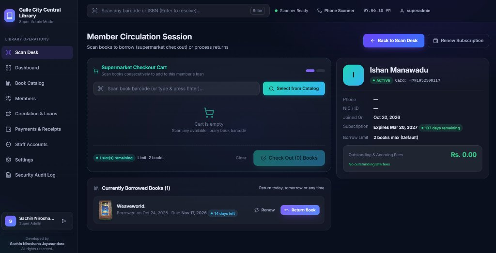

<div align="center">

# 📚 Library Management System
### Professional Desktop Edition for Windows

**High-Speed Barcode Circulation • Built-In Barcode & Label Printer Studio • WhatsApp Reminders • Recurring Member Subscriptions • Anti-Fraud Return Verification • Offline-First SQLite Engine**

[](https://github.com/sac3478/library-management-releases/releases/latest)
[-0078D6?style=for-the-badge&logo=windows&logoColor=white)](https://github.com/sac3478/library-management-releases/releases/latest)
[](https://github.com/sac3478/library-management-releases/releases/latest)
[](mailto:sac3478@gmail.com)

---

[**⬇️ Download Latest Installer (.exe)**](https://github.com/sac3478/library-management-releases/releases/latest) • [**🔑 24-Hour Free Trial Key**](#-24-hour-free-evaluation-license-key) • [**✨ Full Feature Tour**](#-comprehensive-feature-overview) • [**💼 Pricing & Instant Buy ($10 / $29 / $49)**](#-commercial-licensing-pricing--instant-paypal-checkout)

<br />



</div>

---

## 🌟 Executive Overview

**Library Management System (Professional Desktop Edition)** is an enterprise-grade, supermarket-style circulation, barcode printing, and inventory management application engineered for **public libraries, schools, colleges, private reading clubs, and institutional resource centers worldwide**.

Unlike slow, browser-dependent web tools that stop working when the internet drops, Library Management System runs natively on Windows with an embedded, high-speed **SQLite WAL database**. Every daily operation—scanning member cards, checking out carts of books, printing barcode stickers, verifying physical book returns, calculating overdue fines, printing receipts, and generating audit reports—executes in **under 5 milliseconds** with **100% offline reliability**.

---

## 🔑 24-Hour Free Evaluation License Key

We provide an instant **24-Hour (1-Day) Evaluation Product Key** so you can install and test every feature of the software on your own library hardware before purchasing a full commercial license.

> 📄 *(This key is also available directly in [`TRIAL_LICENSE_KEY.md`](./TRIAL_LICENSE_KEY.md) in this repository.)*

```text
LMS-FREE-24HR-DEMO-2026
```

### How the 24-Hour Evaluation Key Works:
1. **Download & Install**: Download the latest `Library-Management-Setup-x.x.x.exe` from the [**Releases**](https://github.com/sac3478/library-management-releases/releases/latest) section and launch the application.
2. **Paste the Key**: Enter `LMS-FREE-24HR-DEMO-2026` on the **Activate Product** screen and click **Activate Application** *(requires a 1-second internet connection to bind the evaluation certificate)*.
3. **Full Unrestricted Access for 24 Hours**: Unlock all Super Admin, barcode circulation, barcode label printing, smartphone scanner, catalog, and reporting features for **24 hours (1 full day)**.
4. **Strict Anti-Abuse Hardware Policy (1 Use Per Computer)**:
   - This evaluation key is cryptographically bound to your computer's unique **Hardware Machine ID (`LM-XXXX-XXXX-XXXX-XXXX`)** upon first use.
   - **Once activated on a computer, the evaluation key cannot be used on that same computer again** (even if the application is uninstalled or reinstalled).
5. **Seamless Upgrade to a Full License (Zero Data Loss)**:
   - When your 24-hour evaluation expires—or if the evaluation key is unavailable—purchase a **Monthly ($10)**, **Annual ($29)**, or **Lifetime ($49)** Product Key online or contact **`sac3478@gmail.com`**.
   - All books, members, loans, payments, and settings configured during your evaluation remain **100% intact** when you activate your full license key.

---

## ✨ Comprehensive Feature Overview

### 1. 🛒 Supermarket-Style High-Speed Scan Desk
- **Zero-Click Context Switching**: Point your barcode scanner at any **Member Card**—the desk immediately opens that patron's live profile, displaying active loans, remaining borrow slots, subscription expiry countdown, and any unpaid late fees.
- **Multi-Book Shopping Cart Checkout**: Scan multiple books one after another into the checkout cart and complete the entire lending transaction atomically with a single click.
- **Instant Audio-Visual Feedback**: Crisp acoustic scan beeps and visual confirmation flashes allow librarians to process long queues without looking at the keyboard.
- **Smart Unknown Barcode Routing**: Scanning an unrecognized barcode immediately prompts the librarian to either register it as a **New Book** (with automatic online ISBN lookup) or assign it to a **New Member**.

### 2. 📱 Dual Barcode Scanner Ecosystem (USB Handheld + Smartphone Camera)
- **Plug-and-Play Hardware Scanners**: Compatible with all standard USB and Bluetooth 1D/2D laser and CCD barcode scanners out of the box, complete with a built-in **Hardware Scanner Diagnostics & Test Utility**.
- **Built-in Wireless Smartphone Camera Scanner**:
  - Don't have a dedicated USB laser scanner on every desk? Click **Phone Scanner** in the top bar and scan the on-screen **QR Code** with any **iPhone or Android** smartphone on your local Wi-Fi network.
  - Instantly turns the smartphone camera into a live wireless barcode reader—AND lets staff snap and upload **physical book cover photos** directly from their phone into the catalog!

### 3. 🏷️ Built-In Barcode & Label Studio (Thermal Roll Printers & A4 Sticker Sheets)
- **Generate Collision-Free Barcodes Instantly**: Don't have pre-printed member cards or books with ISBN barcodes? Generate sequential, guaranteed-unique **Code 128B** barcodes (`BK-00001`, `MEM-00001`) right inside the app with a single click.
- **3 Flexible Label Modes**:
  - **📖 Book Labels with Details**: Print spine/cover stickers displaying the **Library Name, Book Title, Author, Category, Shelf Location, and Code 128B Barcode**.
  - **🪪 Member Card Labels & CR80 ID Cards with Details**: Print member cards or stickers displaying the **Library Name, Member Full Name, Parent/Guardian, Phone, NIC/ID, Subscription Expiry, and Card Barcode**.
  - **⚡ Batch Unassigned Barcodes**: Pre-print sheets or rolls of blank sequential book or member barcodes in bulk and assign them later at the Scan Desk simply by scanning them.
- **9 Built-in Printer Presets (Thermal & Standard A4)**:
  - **Thermal Label Roll Printers** (Xprinter, Zebra, TSC, Munbyn, Brother, Rollo): `50 × 25 mm`, `50 × 30 mm`, `60 × 40 mm`, `38 × 25 mm`, and `CR80 ID Card (85.6 × 54 mm)` with exact single-label page breaks.
  - **A4 Adhesive Sticker Sheets** (Laser / Inkjet): `24-up (3×8)`, `30-up (3×10)`, `14-up (2×7)`, and `8-up CR80 ID Cards (2×4)`.
- **Smart Partial Sticker Sheet Saver**: Re-use partially used A4 sticker sheets by specifying how many sticker slots were already peeled off (`Skip first N used sticker slots`)—zero wasted sticker paper!

### 4. 💬 One-Click WhatsApp Overdue & Renewal Reminders (Zero SMS Cost)
- **Instant Patron Notifications**: Send polite, pre-filled **Overdue Book Reminders**, **Upcoming Due Date Alerts**, and **Membership Subscription Renewal Notices** directly to members via **WhatsApp Web / WhatsApp Desktop** (`wa.me`) with zero monthly SMS gateway fees.
- **International Country Code Support**: Automatically formats phone numbers with international country codes (`+1`, `+44`, `+94`, etc.) and allows staff to customize the reminder text before sending.

### 5. 🛡️ Anti-Fraud Physical Book Return Verification
- **Prevents "Ghost Returns"**: Ensures librarians cannot mark a book as returned unless the physical book is actually in hand at the desk.
- **Hardware Scan-Speed Enforcement**: When physical barcode verification is enabled, the return modal measures keystroke cadence to require a **real optical barcode scan** (via USB handheld scanner or the Mobile Phone Camera Scanner) and **blocks manual keyboard typing** of barcode numbers.
- **Granular Return Policies**:
  - **Global Library Policy**: Super Admin can toggle physical barcode return verification library-wide.
  - **Per-Member Policy Exemptions**: Super Admin can configure individual members (such as institutional borrowers, schools, or reading clubs returning books in bulk) to follow the global policy, strictly require barcode scans, or allow returns without barcode scans.
  - **Super Admin Emergency Override**: Authorized Super Admins can override a damaged/unreadable barcode label with full audit logging.

### 6. 👥 Member Directory, Guardian Tracking & Worldwide Multi-Currency Subscriptions
- **Worldwide Multi-Currency Support**: Defaults to **`$ (USD)`** for new installations and lets you choose any currency symbol worldwide (`$`, `€`, `£`, `Rs.`, `₹`, `A$`, `C$`, `AED`, or any custom currency symbol) during setup or in Settings.
- **Complete Patron Profiles**: Track member name, card barcode, NIC/ID/Passport number, phone, email, residential address, and **Parent / Guardian Name** (with full search support across all fields, including guardian name).
- **Automated Free Trial Period**: Configurable initial free membership window upon registration (e.g., 1 month free included with the one-time registration fee).
- **Configurable Billing Cycles (Globally & Per-Member)**:
  - Support **1-Month (Monthly)**, **2-Month (Bi-Monthly)**, **3-Month (Quarterly)**, or **4-Month (Tri-Annual)** recurring subscription periods.
- **Permanent Per-Member Renewal Discounts**: Assign custom percentage discounts (e.g., student, senior, or VIP discounts) to individual members that automatically apply on every future subscription renewal.

### 7. 📖 Book Catalog, Bulk Excel / CSV Import Wizard & Online ISBN Auto-Fill
- **Bulk Excel / CSV Import Wizard**: Migrate thousands of existing books or members from Excel or Google Sheets (`.csv`) in seconds. Any row missing a barcode automatically receives a unique sequential barcode (`BK-00001` / `MEM-00001`).
- **One-Click Online ISBN Lookup**: Scan or type an ISBN to automatically fetch the book's **Title, Author, Publisher, Publication Year, Category, and Cover Image** from Open Library and Google Books.
- **Super Admin Inventory Safeguards**: Adding new books or increasing copy counts can be delegated to staff, while **reducing copy counts or deleting books from the catalog is strictly restricted to the Super Admin**.

### 8. 🔐 Enterprise Security, Role-Based Access Control (RBAC) & Audit Trail
- **Master Super Admin + Offline Recovery Key**: First-time setup creates the owner's Super Admin account and generates a one-time **20-character Emergency Recovery Key** so you are never locked out of your database.
- **Granular Staff Admin Accounts**: Create individual accounts for each librarian and toggle specific permissions across Circulation, Members, Catalog, Payments, Reports, and Settings.
- **Immutable Security Audit Log**: Every login, checkout, return, override, fee waiver, permission change, and catalog modification is permanently recorded with timestamp and staff username.

### 9. 💾 100% Offline-First Database, Auto-Safety Snapshots & Auto-Updates
- **Zero Cloud Dependency**: All library records live locally on your machine in an ACID-compliant SQLite WAL database—no monthly cloud hosting bills and zero internet required for daily operations.
- **Automatic Rolling Daily & Pre-Restore Safety Snapshots**: Automatically saves rolling daily backups and pre-restore safety snapshots. If a staff member ever restores an older backup by mistake, you can undo it in **1 click** inside `Settings → Backups & CSV Export`.
- **Seamless Background Updates**: Built-in delta updater automatically checks this repository for new releases and lets staff apply updates with a single click.

---

## 🏢 Ideal For

| Institution Type | Why It Fits |
| :--- | :--- |
| **Public & Municipal Libraries** | High-speed barcode scan desk, recurring subscription cycles, and strict staff permission controls. |
| **Schools, Colleges & Universities** | Bulk Excel/CSV student & book import, Parent/Guardian tracking, WhatsApp reminders, and offline reliability. |
| **Private Reading Clubs & Book Rental Shops** | Registration fee + free period + 1/2/3/4-month subscription billing, multi-currency support, and barcode label printing. |
| **Corporate & Institutional Libraries** | Per-member barcode policy exemptions, full security audit trail, and CSV reporting. |

---

## 💼 Commercial Licensing, Pricing & Instant PayPal Checkout

Every installation of **Library Management System** is protected by an **Ed25519 cryptographic digital signature** locked to your workstation's Hardware ID. When you purchase via **PayPal**, our automated licensing server immediately dispatches a pre-loaded **Product Key (`LMS-XXXX-XXXX-XXXX-XXXX`)** straight to your email inbox within seconds!

| License Plan | Price (USD) | Validity Duration | Hardware Binding | Instant Delivery / Action |
| :--- | :---: | :--- | :--- | :--- |
| **🎁 Free Evaluation Trial** | **FREE ($0)** | **24 Hours (1 Day)** | 1 Activation per PC (`Machine ID`) | Use Key: `LMS-FREE-24HR-DEMO-2026` |
| **📅 Monthly License** | **$10 USD** | **30 Days (1 Month)** | 1 Workstation (`Machine ID`) | [**💳 Buy 1-Month Key ($10) Online**](https://library-activation-api.sachinniroshan.workers.dev/buy?plan=monthly) |
| **⭐ Annual License** | **$29 USD** | **365 Days (1 Full Year)** | 1 Workstation (`Machine ID`) | [**💳 Buy 1-Year Key ($29) Online**](https://library-activation-api.sachinniroshan.workers.dev/buy?plan=annual) |
| **🏆 Lifetime License** *(Best Value)* | **$49 USD** | **Permanent (Never Expires)** | 1 Workstation (`Machine ID`) | [**💳 Buy Lifetime Key ($49) Online**](https://library-activation-api.sachinniroshan.workers.dev/buy?plan=lifetime) |

### ⚡ How Instant Automated License Delivery Works:
1. **Pay Online via PayPal**: Select your preferred plan (**$10 Monthly**, **$29 Annual**, or **$49 Lifetime**) and complete checkout with PayPal or Credit/Debit Card.
2. **Instant Email Fulfillment (Powered by Resend)**: As soon as your payment is confirmed, our Cloudflare Licensing Server automatically claims an unused Product Key from our pre-loaded pool and emails it to your PayPal email address immediately.
3. **1-Click Activation**: Paste the received `LMS-XXXX-XXXX-XXXX-XXXX` key into the application's **Product Key Activation** screen—your computer unlocks immediately with zero data loss!

### 📧 Direct Sales, Multi-PC Volume Licensing & Support
If the trial key is unavailable, if your evaluation or subscription has expired, or if you wish to purchase a **Multi-Computer Institutional License**, please contact:

- **Developer & Licensing Vendor**: **Sachin Niroshana Jayasundara**
- **Official Licensing Email**: [**sac3478@gmail.com**](mailto:sac3478@gmail.com?subject=Library%20Management%20System%20—%20License%20Key%20Inquiry)

> 💡 **Tip when emailing**: You can simply request a self-activating Product Key (`LMS-XXXX-XXXX-XXXX-XXXX`), or include your computer's **Hardware ID** (shown at the bottom of the Activation Screen, e.g., `LM-4514-ABED-D670-FA9C`) for immediate fulfillment.

---

## 💻 System Requirements

- **Operating System**: Windows 10 or Windows 11 (64-bit)
- **Processor**: Intel Core i3 / AMD Ryzen 3 or higher (x64)
- **Memory (RAM)**: 4 GB RAM minimum (8 GB recommended)
- **Disk Space**: 250 MB free disk space
- **Barcode Scanner (Optional)**: Any USB or Bluetooth HID barcode scanner, or any iOS/Android smartphone on the same Wi-Fi network
- **Label Printer (Optional)**: Any Thermal Roll Label Printer (50×25mm, 50×30mm, 60×40mm, CR80) or standard A4 Laser/Inkjet Printer
- **Internet Connection**: Required only for 1 second during initial product key activation, optional ISBN book metadata lookup, and software updates. Daily operations run **100% offline**.

---

<div align="center">

**Developed by Sachin Niroshana Jayasundara**  
📧 Licensing & Support: [**sac3478@gmail.com**](mailto:sac3478@gmail.com) • All rights reserved.

</div>
